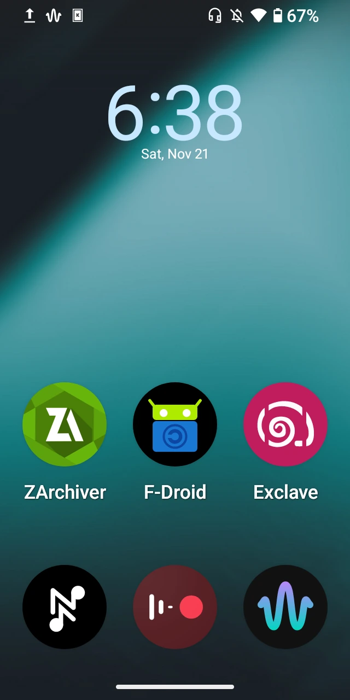
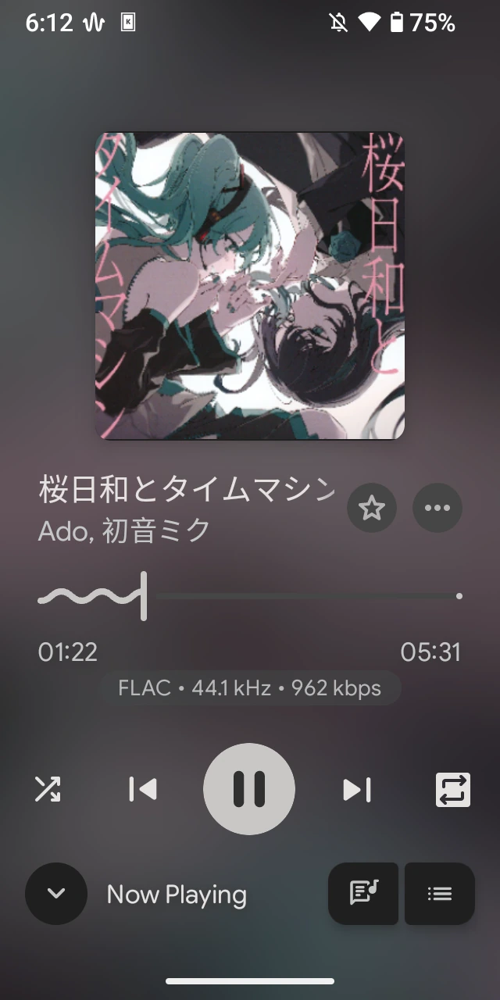
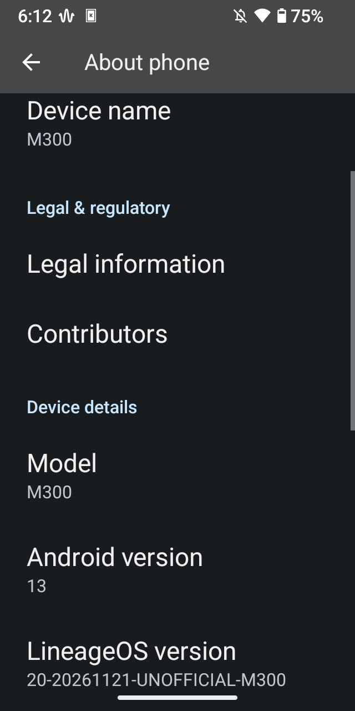
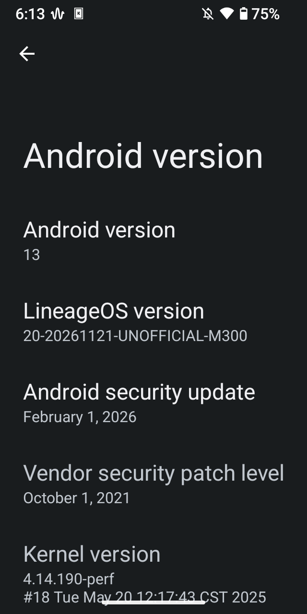

# HiBy Digital M300 LineageOS 20 device tree & builds repo

Unofficial LineageOS 20 device tree for the HiBy Digital M300, based on Android 13.

Making this port because I didn't like the stock, and in my opinion a player(especially with such hardware) shouldn't have GMS unless you use streaming services.
I use Navidrome and local music, so I don't need streaming services.

Even with that - you always can flash the released build onto the device along with GApps or install microG if you didn't like the stock but still need GApps.
(No release yet, but it will be soon! Rn only LOS 20, I will try to port latest 24 too.)

This port combines the stock HiBy 1.62 boot, DTBO and vendor images with LineageOS system, system_ext and product images.
Google apps and services are not included. The original TWRP-oriented tree is available from `reindex-ot/hiby_digital_m300`.

If you have any problems or questions with your M300 or LOS installation - feel free to open an issue in this repo.

Keep in mind that I am not actually an Android dev, so I can't help with EVERYTHING you ask.

This was actually a pretty low effort port, though I did use AI for troubleshooting and a few small patches.

Everything that's used in this repo was written by humans(because I used already existing trees for Snapdragon 665 and LOS as a reference) with the sole exception of contents in the `patches/` dir.

## Screenshots

<p align="center">
  
  
  
  
</p>

*The screenshots were taken with large display scaling and a 3x3 launcher icon grid.*

## Build requirements

- Linux x86_64 host or container with the Android 13 build toolchain
- Git, Git LFS, Python 3 and `repo`
- About 250 GB of free disk space
- 16 GB or more RAM recommended
- 32 GB swap recommended for systems with less RAM

Use `-j1` and CPU affinity on low-memory systems. Increasing the job count can make the build run out of memory.

## Building

Run the following commands from an empty source directory:

```sh
git lfs install
repo init -u https://github.com/LineageOS/android.git -b lineage-20.0 --git-lfs --no-clone-bundle
repo sync -c -j1
git clone -b main https://github.com/kira-we1ss/lineage-m300.git device/hiby/M300
git -C build/make apply device/hiby/M300/patches/lineage-20.0/build-make-wifionly.patch # exclude telephony modules from the build, you'll probably want that
git -C system/vold apply device/hiby/M300/patches/lineage-20.0/vold-exfat-check.patch # fix for SD cards
git -C vendor/lineage apply device/hiby/M300/patches/lineage-20.0/lineage-disable-updater.patch # disable OTA if needed
git -C packages/apps/Settings apply device/hiby/M300/patches/lineage-20.0/settings-m300-maintainer.patch # adds maintainer info to the settings, optional
source build/envsetup.sh
lunch lineage_M300-userdebug
m -j1 systemimage systemextimage productimage vbmetasystemimage vbmetaimage superimage
```

For a single-core build, replace the last three commands with:

```sh
taskset -c 0 bash -lc 'source build/envsetup.sh && lunch lineage_M300-userdebug && m -j1 systemimage systemextimage productimage vbmetasystemimage vbmetaimage superimage'
```

Build artifacts are written to `out/target/product/M300/`. The stock boot, DTBO and vendor images used by the build are in `device/hiby/M300/prebuilt/`.

## Flashing

The bootloader must already be unlocked (As far as I know it's unlocked from the factory?).
Use a USB data cable and a recent Android platform-tools installation.

The first installation requires a factory reset and erases the internal storage. Back up your data and remove the SD card before flashing. Keep the stock 1.62 fastboot ROM available for recovery.

Boot into fastbootd from Android and verify the mode and slot:

```sh
adb reboot fastboot
fastboot getvar is-userspace
fastboot getvar current-slot
```

Continue only if `is-userspace` reports `yes` and the player shows the `fastbootd` title.
The commands below use slot A.
If `current-slot` reports `b`, replace every `_a` suffix with `_b`.
Do not flash both slots if you want an easier recovery if something goes wrong.

If you built LOS from source, run these commands from the LineageOS source directory:

```sh
images=out/target/product/M300
stock=device/hiby/M300/prebuilt

fastboot flash super "$images/super.img"
fastboot flash boot_a "$stock/boot.img"
fastboot flash dtbo_a "$stock/dtbo-1.62.img"
fastboot flash vbmeta_a "$images/vbmeta.img"
fastboot flash vbmeta_system_a "$images/vbmeta_system.img"
```

If not - you can just cd into directory where you downloaded images from releases and run this:

```sh
fastboot flash super super.img
fastboot flash boot_a boot.img
fastboot flash dtbo_a dtbo-1.62.img
fastboot flash vbmeta_a vbmeta.img
fastboot flash vbmeta_system_a vbmeta_system.img
```

For the first installation, reboot into recovery, select `Factory data reset`, then select `Reboot system now`.
Do not skip the factory reset when coming from stock firmware or LOS will not boot.

OTA updates are disabled because no update server is provided. Install newer builds manually using the fastboot images above.

## Verified on device

- System boot
- All basic features(touchscreen, hardware acceleration, etc.)
- Wi-Fi
- Bluetooth
- Microphones
- DAC and its sound profile, audio playback with both speakers and headphones via USB-C(no 3.5mm ones to test on)
- SD card support, including exFAT recovery during boot

## Known issues

- The side switch does not work.

## Not tested yet

- Bluetooth audio and codec negotiation, including LDAC
- DSD and bit-perfect playback with the official HiBy profiles
- A `user` build signed with release keys

This is a development port, not a stable release. Keep the stock images and a working recovery path available when testing.
